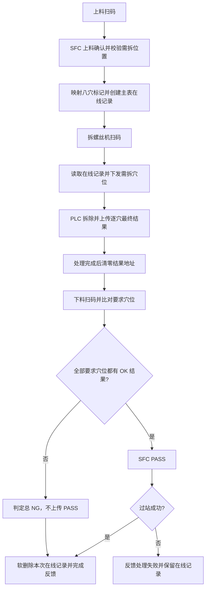

# Socamm 重工线业务流程说明

## 1. 文档范围与依据

本文记录 core 3.2.0 重写后的业务实现，依据已确认的大流程和《Socamm重工线-PLC通讯协议.xlsx》整理。

- 整线共四台机：上料机、拆螺丝1、拆螺丝2、下料机。
- 两台拆螺丝机的协议和业务相同，本文按一类机台说明，代码保留两个 Flow 入口。
- 本文区分已实现规则和保留的重复上传/上料策略；验证范围见《重构验证记录》。
- 当前代码已按本文实现。主表字段和 SFC 接口报文保持兼容；设备接入、配置、Flow 与页面已迁移到 core 3.2.0。
- 原始协议仅供追溯，地址和实际实现以当前代码为依据；已明确确认的交互调整见第 3 节。

## 2. 整线业务与数据

整线流程：

> 上料扫码 → SFC 上料确认并取得需拆位置 → 解析为八穴标记并建档 → 拆螺丝机扫码 → 下发需拆穴位 → PLC 加工并上传穴位结果 → 下料扫码 → 按上料要求逐穴比对 → 全部要求穴位 OK 则总 OK，否则总 NG。



曲线保存是独立旁路：ScrewReceiveJob 接收螺丝批事件 → 读取 PLC 关联信息 → 保存本地文件；不参与逐穴最终质量判定。

### 2.1 Flow 与处理职责

| 机台或入口 | 当前实现 | 职责 |
|---|---|---|
| 上料机 | `LDFlow`，FlowName 为 `LD` | 扫码、SFC 上料确认、解析需拆穴位、创建生产记录 |
| 拆螺丝1 | `UnscrewFlow1`，FlowName 为 `UNSCREW1` | 扫码、查询在线记录、下发需拆穴位 |
| 拆螺丝2 | `UnscrewFlow2`，FlowName 为 `UNSCREW2` | 与拆螺丝1相同，共用 `ScrewFlowBase` |
| 两台拆螺丝机的产品交互 | `ScrewFlowBase` | 扫码下发、接收 PLC 穴位最终结果并更新主表 |
| 两台拆螺丝机的拧紧接收任务 | `ScrewReceiveJob` | 订阅两把拧紧枪的结果和曲线，关联 PLC 并保存本地曲线文件 |
| 下料机 | `UldFlow`，FlowName 为 `ULD` | 扫码、取得生产记录、逐穴比对、条件满足时调用 SFC 过站、发布结果并结束在线周期 |

各站交互逻辑直接位于 Flow，不再设置独立工站 FlowService。`ScrewFlowBase` 中扫码与 PLC 最终结果各自轮询。拧紧结果和曲线由独立的 `ScrewReceiveJob` 接收，订阅随 Job 启停配对，不随 Flow 启停；Job 仅在 UNSCREW1 / UNSCREW2 机台运行。IO、产品数据与 SFC 仍作为基础能力注入。扫码与 PLC 产品码统一在 IO 边界使用框架 TrimControlCharacters() 裁剪两端控制字符、空白和空字符，调用方不重复清洗；PLC 读取失败仍返回原结果。PLC 字符串读取长度由各调用方显式传入，当前均为30；该长度不用于扫码产品码校验。

### 2.2 主表与在线记录

业务仅使用 `flow` 主表，不使用历史表，也不搬移或归档数据。

| 字段 | 含义 |
|---|---|
| `ProductCode` | 产品码 |
| `UnScrewCaves` | 八个穴位的需拆标记，逗号分隔；1 表示需要拆，0 表示不需要拆 |
| `Locations` | SFC 返回的原始位置字符串 |
| `ResultJson` | PLC 上传的穴位拆除结果集合，每项包含 `Cave` 和 `Result` |
| `IsDeleted` | 0 表示在线；1 表示已下线、软删除，记录仍留在主表 |
| `Id`、`CreateTime`、`UpdateTime` | 主表记录标识与时间 |

例如，`UnScrewCaves = "1,0,1,0,0,0,0,0"` 表示需要拆穴位 1、3，不是“需要拆穴位 1、0、1”。

工站按“产品码相同且 `IsDeleted=0`”查询，取最新 ID 的记录。报表查询主表，包含已软删除的下线记录。

当前上料每次创建新记录，不会自动清理同产品码已有的在线记录。重复上料的周期处理规则尚未另行变更。

## 3. 已确认的 PLC 交互规则

### 3.1 扫码交互

上料、拆螺丝、下料的扫码业务均按以下闭环组织：

1. PLC 将扫码触发置 1。
2. 软件触发扫码并处理本工站业务。
3. 软件写入相关输出数据、回写扫码结果。
4. 最后清零扫码触发。

上料和拆螺丝机使用 `D100` 触发、`D200` 反馈、`D201` 产品码；下料机使用 `D101` 触发、`D201` 反馈、`D232` 产品码。

拆螺丝机的扫码、产品码下发、需拆穴位下发和更新标记属于同一次交互，不拆成“扫码”和“通用”两个独立工位。

### 3.2 曲线保存

- 曲线数据来自螺丝批回调，PLC 只提供产品码、穴位、螺丝批编号和程序号等关联信息。
- 使用同一种曲线保存地址模型，按两个工位提供两套地址；模型内的螺丝信息集合可包含不同数量的螺丝项。
- 保存到本地文件，不将曲线或螺丝批回调结果写入业务主表。
- 曲线保存交互只读取 PLC，不清零，也不回写 PLC。

### 3.3 穴位最终结果保存

- 只有工位2上传穴位最终拆除结果。
- 使用独立的结果保存地址模型：产品码、穴位、拆除结果。
- 收到结果后尝试保存到主表；交互执行完成后由框架 Runtime 将结果地址清零，清零表示本次交互已处理。
- 不增加独立的处理结果反馈地址。
- 业务成功、业务失败或未预期异常处理完成后均清零；清零不表示数据库保存成功，也不表示拆除质量 OK。

上述规则已落实。拆螺丝扫码与穴位结果保存统一使用框架 Runtime 触发入口，在本次交互处理完成后清零，不区分成功或失败。已请求取消时仍遵循框架取消契约。

LDFlow、UldFlow、ScrewFlowBase 的扫码处理方法不包裹外层通用 try-catch。预期业务失败仍按协议反馈 2 并返回 OperationResult；未预期异常由 Runtime 统一记录和处理，取消直接传播，Flow 不在异常分支补写反馈。

## 4. 上料机业务：LDFlow

### 4.1 正常流程

1. 收到 PLC 扫码触发，调用产品扫码枪取得产品码。
2. 以产品码为 `SN` 请求 SFC 上料确认接口。
3. 解析返回的 `GROUP`、`DEKIT_LOCATION`，不使用 `rc` 判断上料确认。
4. 将响应与配置的站点组分别按逗号拆分，有任一站点匹配即允许上料确认。
5. 按八穴映射逐一检查同号的 LGA `L` 位置和 Socamm `J` 位置；两者同时存在才表示该穴需拆。空位置或未成对位置表示相应穴位不需拆；如果八穴均不需拆，则上料反馈 NG，不建档。
6. 将需拆位置映射为八个穴位标记。
7. 创建 `flow` 在线记录，保存产品码、八穴需拆标记和原始位置字符串。
8. 建档成功后下发产品码，反馈扫码业务成功；按约定最后清零扫码触发。

### 4.2 位置与穴位映射

| 穴位 | LGA 位置 | Socamm 位置 |
|---|---|---|
| 1 | L172 | J172 |
| 2 | L170 | J170 |
| 3 | L168 | J168 |
| 4 | L212 | J212 |
| 5 | L174 | J174 |
| 6 | L176 | J176 |
| 7 | L178 | J178 |
| 8 | L180 | J180 |

软件仅在同一穴位的 `L` 和 `J` 位置同时出现时，将对应数组元素置 1，其余为 0。例如 `L172,J172,L170` 只标记穴位1，穴位2不需拆；空位置、仅单边位置或 `L172,J170` 均为八穴全0。未知位置不对应任何穴位。数组以逗号分隔字符串保存，后续下发和最终判定使用同一份数据。

### 4.3 失败与当前实现边界

- 扫码、SFC 上料确认或建档返回业务失败时，本次上料未成功，扫码反馈为 2；不清空产品码地址，仅建档成功后写入本次产品码。
- SFC 请求、响应模型只包含带 JSON 字段名映射的自动属性，不包含必填标记或业务计算属性；`INvdSfcService.CheckAsync` 仅使用 GROUP 和 DEKIT_LOCATION，不解析或判断 rc；普通过站 StationRecordAsync 仍按 rc=0 判断成功。无效 JSON 按解析失败处理。八穴标记与原始位置作为业务操作结果返回，不放入响应模型。Flow 和页面仅判断 OperationResult，不读取 SFC 响应字段，也不构造协议请求。
- 站点不匹配、通信失败、响应为空/无法解析返回明确失败；上料确认响应中的 rc 缺失、非0或格式不符不影响站点和位置判断。
- 未成对位置与未知位置不置位，其他有效配对仍保留；位置为空或没有任何有效配对时返回八穴全0，LDFlow 判定“没有穴位需要拆”，反馈上料NG并停止建档。
- 正常上料确认和屏蔽测试都要求至少一个需拆穴位；八穴全0时，D200反馈2，提示“没有穴位需要拆”，不写产品码、不建档。已有零需拆记录的下料仍沿用总NG且不上传PASS的防御性规则。

## 5. 拆螺丝机业务：ScrewFlowBase / UnscrewFlow1 / UnscrewFlow2

### 5.1 扫码与穴位下发

1. 收到 PLC 扫码触发，取得产品码。
2. 按产品码查询最新在线主表记录。
3. 读取上料阶段保存的 `UnScrewCaves`，解析为八个 `INT` 元素。
4. 依次下发需拆穴位数组 `D233~D240`、产品码 `D201`、更新标记 `D232`。
5. 回写扫码结果 `D200`，按约定最后清零扫码触发 `D100`。
6. PLC 根据收到的标记完成对应穴位的实际拆除动作。

两台拆螺丝机使用相同流程，不在拆螺丝扫码阶段重新执行 SFC 上料确认。上料保存的要求是本次生产记录的判定依据。

当前代码没有按“已上传哪些结果”过滤下发数组，仍下发上料保存的完整需拆数组。本文不另行引入机台分工或重复加工策略。

没有在线记录或需拆标记非法时，不下发正常加工数据，回写扫码失败2并返回带上下文的错误；不会沿用旧版“没有数据也成功”的行为。

### 5.2 本地曲线保存：同一模型，两套地址

| 地址模型实例 | 产品码 | 穴位 | 螺丝信息集合 |
|---|---|---|---|
| 工位1曲线保存 | D101 | D132 | 螺丝#1：程序号 D133、螺丝批编号 D169；螺丝#3：程序号 D134、螺丝批编号 D170 |
| 工位2曲线保存 | D135 | D166 | 螺丝#2：程序号 D167、螺丝批编号 D171 |

处理步骤：

1. 收到某把螺丝批的曲线回调。
2. 用回调的螺丝批 ID 匹配 PLC 关联信息，确定产品码、穴位和螺丝编号。当前匹配顺序为 D169、D170、D171，匹配后即返回。
3. 将关联信息与曲线数据组合，保存本地 JSON 文本文件。
4. 不写业务数据库，不清零或回写上述曲线关联地址。

文件保存根目录使用 `IConfiguration.GetDataDirectory()`，其下按 `screw/yyyy-MM/` 分月保存。文件名包含产品码、穴位、螺丝编号、螺丝批 ID 和完整日期时间。仅保存本地文件，不提供曲线展示、内存缓存或历史查询。

无法匹配有效关联时，保留原始曲线为明确标记的UNMATCHED文件并记录告警，不伪造有效产品/穴位。螺丝批的完成结果由独立接收 Job 记录；回调和曲线均不替代PLC上传的穴位最终结果。

### 5.3 工位2最终结果上传

| 字段 | 地址 | 含义 |
|---|---|---|
| 产品码 | D135 | 本次结果所属产品，读取长度 30 |
| 穴位 | D166 | 本次结果所属穴位，业务范围为 1~8 |
| 拆除结果 | D168 | 1 为 OK，2 为 NG；处理完成后统一清零 |

处理步骤：

1. 轮询发现 D168 有待处理的拆除结果。
2. 读取 D135 产品码、D166 穴位及结果值。
3. 查询产品的最新在线主表记录。
4. 将该穴位结果保存到 `ResultJson`。
5. 本次处理完成后，无论成功或失败均由 Runtime 清零 D168，不另写处理结果地址。

数据库存储示例：

```json
[
  { "Cave": 1, "Result": "OK" },
  { "Cave": 3, "Result": "NG" }
]
```

轮询发现非0的D168时读取产品和穴位；只接受穴位1~8、质量1/2，非法值或数据库保存失败仍在处理完成后清零，由 Runtime 记录失败。有效结果采用追加存储，判定仍取同穴位最先保存的一条，保留原行为；不引入覆盖/返工策略。上传的额外穴位会留存，但不参与本次需拆集合的总判定。

## 6. 下料机业务：UldFlow

### 6.1 总结果判定规则

1. 收到下料扫码触发，取得产品码。
2. 取得该产品最新在线记录，读取上料保存的需拆标记与 PLC 已上传的穴位结果。
3. 从八穴标记中提取值为 1 的穴位，形成“本次要求拆除的穴位集合”。
4. 对集合内每个穴位检查：存在对应结果且结果为 OK，才算该穴位完成；没有结果或结果为 NG，均判该穴位 NG。
5. 所有要求穴位都为 OK，总结果才是 OK；存在任意缺失或 NG，总结果为 NG。

不要求拆除的穴位不参与总结果判定。不能用“收到的结果条数等于需拆数量”代替按穴位逐一比对，也不能用曲线文件是否存在代替最终拆除结果。

示例：上料要求穴位 1、3。

| 收到的穴位结果 | 总结果 | 原因 |
|---|---|---|
| 1=OK，3=OK | OK | 要求穴位全部完成且 OK |
| 1=OK，缺少3 | NG | 穴位3没有完成结果 |
| 1=OK，3=NG | NG | 穴位3拆除 NG |
| 1=OK，2=OK | NG | 穴位2不替代缺失的穴位3 |

没有在线记录、结果内容无法解析等情况，不能直接视为“全部要求穴位已拆 OK”。未找到在线记录返回业务失败；结果内容解析异常交给 Runtime 处理，均不继续调用 SFC 或软下线。下料结果展示待后续需求明确。

### 6.2 SFC 和下线

- 当前代码仅在要求穴位均未判 NG 时，调用 SFC 过站接口，提交 `RESULT=PASS`；存在 NG 时不调用该 PASS 接口。
- SFC 过站成功与否是接口处理结果，不能改变 PLC 已上传的穴位拆除质量。
- 不维护展示状态缓存，不发布产品码或逐穴结果事件；移除拆除结果页面入口和展示实现，保留 PCB 图片及穴位坐标资源。
- 本周期下线使用主表软删除，不转移历史表。
- 在质量判定、必要的SFC PASS处理完成后，才软删除本次取出的主表记录。SFC调用失败不软删，允许重试；质量NG可正常软下线。
- 当前没有单独持久化产品总 OK/NG 字段，逐穴结果留在 `ResultJson` 中。

### 6.3 PLC 反馈与总质量的区别

总质量按“要求穴位全部拆OK才总OK，否则总NG”计算，保留在本次业务判定及完成日志中。

D201继续表示下料处理反馈：处理成功1、扫码/在线查询/SFC/数据操作失败2。质量NG但本次下线处理成功仍反馈1；不能将该反馈当成产品总质量。未新增PLC质量地址，也未擅自将D201改为质量位。

## 7. 屏蔽 SFC 时的现有行为

- Shield 配置仅保留 SFC 开关。关闭 SFC 后，上料机首页屏蔽区域显示 1–8 穴位选择，点击“应用需拆穴位”后供后续上料使用；开启 SFC 时隐藏选择区域并禁止应用。
- SFC 被屏蔽时，上料不调用真实接口，使用 `FlowDictKeys.TestCaves` 提供的八穴标记；该数组默认全为 0，仅在当前进程内保存，重启后恢复默认值。页面重新创建时回显当前已应用标记。
- SFC 被屏蔽时，过站接口直接返回模拟成功。
- 扫码设备返回 NG 且 SFC 被屏蔽时，IO 生成 Fake 产品码继续处理；SFC 开启时保留扫码失败信息。扫码成功不根据 Err/NG 等文本生成假码，也不限制产品码长度，仅清理两端控制字符并拒绝空码。

这些屏蔽/测试分支不等同于正常生产流程；正常 SFC 开启时仍使用接口返回的需拆穴位。

## 8. 重构后明确的实现边界

- 已修正扫码提前清零、曲线关联地址清零、穴位结果先清零后保存的旧行为。
- 已修正SFC校验失败仍可能返回成功、无在线产品仍下发成功反馈、缺失/无效结果被异常分支掩盖的问题。
- 下料结果由 `FlowMain.GetFinalResult()` 按需拆穴位逐一比对；零需拆集合总NG。逐穴结果仍在主表，总质量暂不新增数据库字段。
- 重复上料仍新增周期，不自动清理同码旧在线记录；在线查询取最新ID。重复穴位结果仍追加、按首次结果判定，不引入未经约定的覆盖策略。
- 下料先读取并比对结果，再按条件调用SFC；需要PASS而SFC失败时不下线。质量NG不调用PASS接口，但可正常软下线。
- 常规PLC写入由IO最多尝试三次，业务层只等待，不增加第二层重试；失败原因写入日志。现场PLC超时/报警逻辑需由电控联调确认，软件不新增报警地址。
- 结果保存触发在处理完成后统一清零，不区分成功或失败；清零写入若失败，下轮仍可能再次接收到同一触发。结果采用原有追加策略，首次判定值不被后续记录覆盖。
- 产品报表使用框架分页和主表查询，包含软下线记录；曲线仅按年月保存本地文件。

## 9. 设备配置与代码边界

代码通过设备 ID 获取本机 PLC、扫码枪和螺丝批，不在 Flow 中固化品牌、IP、端口等连接信息。实际连接参数由设备配置管理。

设备ID为 `MainPlc`、`ProductScanner1`；拆螺丝机另外使用 `Tightening1`、`Tightening2`。VLib通过独立驱动实现 `ITighteningDevice`，详见 `VLib设备接入.md`。不再使用旧工厂或业务层手写连接/重连。

## 10. 代码定位

- `src/Tm.Ant.Module.Rework/Flows/LDFlow.cs`：上料扫码与建档入口。
- `src/Tm.Ant.Module.Rework/Services/Common/NvdSfcService.cs`：SFC 上料确认、位置校验与穴位映射、PASS 过站。
- `src/Tm.Ant.Module.Rework/Jobs/ScrewReceiveJob.cs`：拧紧枪结果和曲线订阅、曲线关联与本地保存。
- `src/Tm.Ant.Module.Rework/Flows/UnscrewFlow.cs`：两台拆螺丝机的具体入口与共用 ScrewFlowBase，处理扫码下发和 PLC 穴位最终结果保存。
- `src/Tm.Ant.Module.Rework/Provider/ScrewCurveProvider.cs`：本地曲线文件存储。
- `src/Tm.Ant.Module.Rework/Services/Common/ProductService.cs`：主表新增、在线查询、穴位结果更新和软删除。
- `src/Tm.Ant.Module.Rework/Entities/FlowMain.cs`：需拆集合和逐穴结果比对。
- `src/Tm.Ant.Module.Rework/Flows/UldFlow.cs`：下料质量判定、SFC 过站及结果发布。
- `src/Tm.Ant.Module.Rework/Models/Pto/ScrewAddress.cs`：当前业务 PLC 地址。
